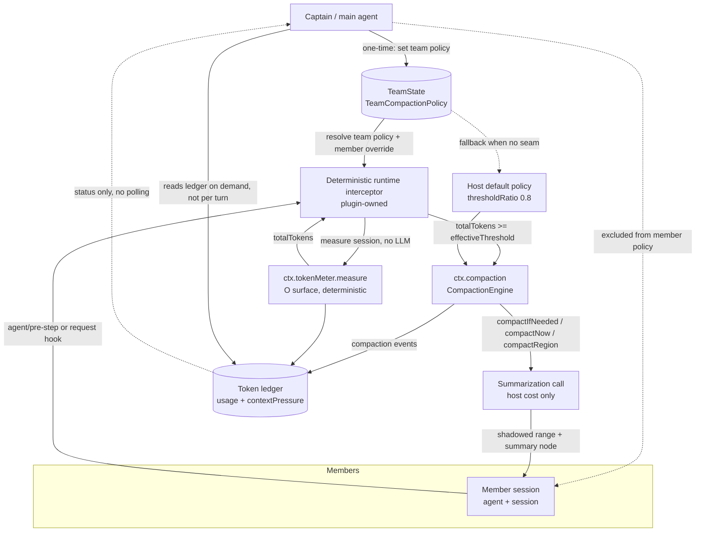

# Subagent compaction budget: captain-governed, token-efficient member compaction

Status: **design accepted for review; implementation not started.** No product code
artifact exists for this design. Everything below is a proposed mechanism; the
only verified claims are the host/plugin API facts explicitly cited to source.

- Date: 2026-11-04 (Asia/Shanghai)
- Worktree: `/Users/openclaw/agent-team-wt/compaction-policy-design`
- Branch: `codex/compaction-policy-design`
- Classification: B-class design work; docs only, no source/tests/skills touched
- Host under study: `@deepseek-ai/dsh-compaction-basic@0.2.1-rc.5`,
  `@deepseek-ai/dsh-compaction@0.2.1-rc.5`,
  `@deepseek-ai/dsh-token-meter@0.2.1-rc.5`
- Plugin under study: AgentTeams (`src/tools.ts`, `src/index.ts`, `src/types.ts`,
  `src/capabilities.ts`, `src/harness-compat.ts`)

---

## 1. Problem statement and constraints

### 1.1 The problem

The captain (main agent) spawns durable member subagents to do long, multi-turn
work. Each member session accumulates its own context. Host compaction is
governed by `@deepseek-ai/dsh-compaction-basic`, whose default automatic trigger
is a **global** policy:

- `thresholdRatio` default `0.8`,
- `headroomTokens` default `65536`,
- `retainRatio` default `0.16` (or `retainTokens`),
- `compactionRetries` default `1`,
- `maxOverflowRetries` default `1`,
- `auto` default `true`,
- plus `modelPolicies[]` per exact provider+model route.

See `.../dsh-compaction-basic/lib/types/types.d.ts` (`BasicCompactionConfig`,
`CompactionPolicyConfig`, `ModelCompactPolicyConfig`) and
`.../lib/types/config.d.ts` (`resolveConfig`, `resolveTargetPolicy`,
`resolveCompactSpec`).

The desired behavior: **member** compaction should kick in *earlier* than the
host default, so a member's working context is compacted while it is still well
inside the window and the summarization call has room to run. The main agent
(captain) should be able to *govern* that lower threshold per team (and, if
desired, per member), while the captain itself stays cheap.

### 1.2 Constraints (from the task and from the host)

1. **The subagent compaction threshold must be lower than the host default and
   captain-controlled.** The captain, not the member, decides the policy.
2. **The control mechanism must not add repeated captain LLM turns or tool
   calls** just to watch members. Monitoring must be push/event-driven or
   member-local, never "the captain polls every N seconds".
3. **`modelPolicies` are keyed by exact `provider`+`model` and are global.**
   A policy override is matched by route string and applies to *every* agent on
   that route — captain included — regardless of team membership. So a
   route-keyed override is **not** a team-scoped knob.
4. **Prefer deterministic host/runtime logic over asking an LLM to decide when
   to compact.** The threshold decision must be arithmetic on a measured token
   count, not a model judgment.
5. This task is **design only**. No code, no dependency changes, no tests
   modified. The deliverable is this document plus small fixture-free docs if
   needed (none are needed).

### 1.3 Why a global `modelPolicies` override is insufficient

`ModelCompactPolicyConfig` is `{ provider, model, ...policy }`, and
`resolveTargetPolicy(config, target)` merges an override over the default by
**exact `provider`/`model` route** (`config.d.ts`, and the loader rejects
duplicate targets). Concretely:

- If the captain and the members run on the same route (very common: same
  provider/model), a route override to `thresholdRatio: 0.55` also changes the
  **captain's** threshold to `0.55`. That compacts the captain more
  aggressively than intended and can hurt the very coordination context we want
  to protect.
- If members run on a different route than the captain, a route override is
  *coarse*: all teams and all members on that route share it. There is no
  team-scoped or member-scoped key in the host config vocabulary.
- `resolveCompactSpec(policy, contextWindow, reservedCompletionTokens)` binds
  the pressure budget to the **context window**, so a single ratio is not a
  stable absolute budget across heterogeneous member models.
- A captain cannot change it at runtime for its members, because `compactIfNeeded`
  re-resolves the policy internally from the service config; there is no
  per-call policy argument (see §3 and §8).

Therefore the host config vocabulary cannot express "this team's members compact
at 0.55, the captain still at 0.8". A team-scoped policy layer is required.

### 1.4 Why captain polling is rejected if it adds repeated LLM/tool calls

A naive design is: captain periodically calls a tool like
`agent_teams_compact_member` for every member. That is rejected because:

- Each check is at least **one tool call per member per interval**, and the
  result re-enters the captain's context as a tool result, causing **extra
  captain LLM turns** to interpret the results. Over a long team run this
  scales as `O(members × ticks)` captain calls and burns exactly the tokens this
  design is supposed to save.
- It couples compaction latency to the captain's scheduling cadence, not to the
  member's actual context pressure.
- It can only act when the member is idle: the existing
  `agent_teams_compact_member` calls `ctx.compaction.compactNow`, which routes
  through `agent.runMaintenance`, which is **idle-only** and throws
  `ManualCompactionError('busy')` when the agent is active
  (`dsh-compaction-basic/lib/index.js`, `compactNow`).
- The captain would need to reason about *when* to check — an LLM judgment where
  deterministic arithmetic is available.

Any design whose steady-state captain LLM calls or tool calls are `> 0` for
monitoring is **not acceptable**. §5 fixes the budget at `0` extra calls.

---

## 2. Options matrix

Five options plus a sixth composite. Scores are relative (higher is better for
"token cost" meaning lower token cost; for the other columns higher is better),
on a 1–5 scale. "Captain controls threshold?" is yes/no.

| Option | Mechanism | Token cost | Correct-ness | Host compat | Impl risk | Captain controls threshold? |
|---|---|---:|---:|---:|---:|---|
| **A. Host `modelPolicies` override (global)** | Add `{provider, model, thresholdRatio: 0.55, ...}` to compaction-basic config | 5 (no per-turn cost) | 2 (coarse; hurts captain on shared route) | 5 (public config) | 5 (config only) | Partial — controls route, not team/member |
| **B. Captain polling + `compactNow`** | Captain tool loop calls `agent_teams_compact_member` per member per tick | 1 (extra tool calls + LLM turns every tick) | 3 (idle-only; latency-bound) | 4 (uses existing tool) | 3 | Yes, but pay-per-check |
| **C. Member self-check + self-compact tool** | Each member, at a step boundary, measures its own context and calls its own compaction tool when below host threshold | 4 (no captain cost; member-side cost) | 3 (member decides; can be wrong/idle-limited) | 3 (needs a member-visible tool + policy) | 3 | Indirect — captain sets tool policy |
| **D. Deterministic runtime interceptor/hook + team-scoped policy** | Plugin registers a host request/step hook that resolves the caller's team policy, deterministically `measure()`s pressure, and compacts before overflow | 5 (no captain cost; local deterministic work) | 5 (arithmetic on measured tokens) | 2–3 (depends on an override seam that does not exist yet; see §8) | 2–3 | **Yes** — team-scoped, persisted once |
| **E. Prompt-only threshold instruction** | Tell the member in its persona: "compact yourself before you reach X% of your window" | 3 (no machinery) | 1 (relies on model self-report; no enforcement) | 5 (prompt only) | 5 | No — the model decides |
| **F. Composite (recommended): D + safe fallbacks** | D as primary; graceful degradation to member self-check (C) or host default when the override seam is absent | 4–5 | 4–5 (with explicit degradation) | 3–4 | 2–3 | **Yes**, with documented fallback |

Scoring notes:

- **A** is cheap and compatible, but is exactly the "insufficient" case in
  §1.3: it cannot distinguish captain from member on a shared route, and it is
  not team-scoped.
- **B** fails the hard token budget (see §5). It is retained in the matrix only
  to be explicitly rejected.
- **C** removes captain cost, but "the member decides when to compact" is an
  LLM-ish judgment unless the measure is deterministic — and a bare member tool
  has no lower-than-host threshold unless the tool itself enforces one. It is a
  useful *fallback* for hosts without the D seam.
- **D** is the only option that is simultaneously team-scoped, deterministic,
  and captain-controlled at zero steady-state captain cost. Its risk is host
  compatibility: today there is no per-call policy override (see §3, §8).
- **E** is prompt-only and cannot guarantee the threshold. Rejected as a primary
  mechanism; usable only as belt-and-suspenders.
- **F** is the recommended composite: implement D where the host exposes the
  seam, degrade explicitly otherwise, and never silently fall back to a
  *higher* effective threshold than intended.

---

## 3. Recommended architecture

### 3.1 Summary

A **team-scoped compaction policy** is written once by the captain (through a
tool / UI / config surface) and persisted in `TeamState`. A **deterministic
runtime interceptor** attached to member sessions resolves the calling
member's team policy, measures context pressure locally via
`ctx.tokenMeter.measure(session)` — **no LLM call** — compares the measured
tokens against the team's *effective threshold*, and asks the host compaction
engine to compact **before** the host's own threshold would fire.

The captain pays:

- **one-time** config cost (a single write/turn) to set the policy, and
- **zero** steady-state LLM turns and **zero** steady-state tool calls for
  monitoring.

### 3.2 Policy shape (team-scoped, persisted once)

Proposed additive, optional `TeamState` field (design only — not implemented):

```ts
// DESIGN ONLY — not implemented.
interface TeamCompactionPolicy {
  /** Lower than host default 0.8; policy default, not measured proof. */
  shortContextThresholdRatio: number   // recommended 0.55
  /** More aggressive ratio for urgent/overflow-adjacent pressure. */
  urgentThresholdRatio: number         // recommended 0.45
  /** Optional per-member overrides, keyed by member name. */
  memberOverrides?: Record<string, Partial<TeamCompactionPolicy>>
  /** Which members this applies to; default "members" (captain excluded). */
  scope: 'members'
  /** Set by the captain; recorded for audit. */
  createdAt: number
  updatedAt: number
}
```

Default values: `0.55` recommended short-context and `0.45` urgent, versus host
`0.8`:

- `shortContextThresholdRatio = 0.55` (recommended short-context)
- `urgentThresholdRatio = 0.45` (recommended urgent)
- host default for comparison: `thresholdRatio = 0.8`

**These numbers are policy defaults, not measured proof.** `0.55`/`0.45` are
chosen to leave summarization headroom and to trigger well before the host's
`0.8`. They are *not* derived from a benchmark run in this task; a future
implementation phase must validate them empirically (see §7, Phase 4).

Note the direction: `urgentThresholdRatio` (0.45) is *lower* than
`shortContextThresholdRatio` (0.55), i.e. the urgent mode compacts **earlier**,
not later. This is intentional: when a member is close to overflow or has
already produced a context-window error, we want a larger retained region
dropped into a summary, hence a more aggressive (lower) ratio.

### 3.3 Runtime resolution (member-local, deterministic)

At the host's per-agent step boundary (or equivalent request hook), the
interceptor:

1. Identifies the session as an AgentTeams **member** (not the captain). This
   is a membership lookup against the persisted `TeamState`, keyed by the
   member's durable session id / member id.
2. Loads the team's `TeamCompactionPolicy` (or the team's default when absent).
3. Applies any per-member override.
4. Resolves the member's routed provider/model and computes the concrete token
   budget the same way the host does:
   `resolveCompactSpec(policy, contextWindow, reservedCompletionTokens)`.
5. Calls `ctx.tokenMeter.measure(agent.session)` (deterministic, O(surface),
   no LLM) to get `totalTokens`.
6. If `totalTokens >= effectiveThresholdTokens` and no compaction is already
   active, invokes the host compaction engine **before** the host default fires.

Steps 1–6 are pure runtime arithmetic plus one local measurement. No captain
LLM turn, no captain tool call, no new network request until compaction itself
runs (and compaction cost is the host's normal summarization cost, not a
captain cost).

### 3.4 The seam problem (honest statement)

The recommended D option depends on a seam the host does not currently expose
cleanly. Verified from source:

- `CompactIfNeeded(agent, 'pressure'|'context-overflow', signal)` re-resolves
  the policy internally:
  `const policy = resolveTargetPolicy(this.config, target)`
  (`dsh-compaction-basic/lib/index.js`, `compactIfNeeded`). There is **no
  per-call policy argument**, so a plugin cannot hand it a member-specific
  lower threshold.
- `compactNow(agent, signal, sourceCommandId?)` runs through
  `agent.runMaintenance`, which is **idle-only** and throws
  `ManualCompactionError('busy')` when the agent is active. So it cannot be used
  mid-turn at a pressure boundary.
- `compactRegion(start, end, agent, signal)` can compact a specific balanced
  range, but the caller must select the range and own the "is this the right
  moment / right amount" decision.

Consequences for this design:

- The *policy resolution* (team-scoped threshold, per-member override,
  deterministic measurement) is implementable today in plugin code.
- The *enforcement below the host threshold during an active turn* requires
  either (a) a host API that accepts a policy override for
  `compactIfNeeded`, or (b) a host hook that runs the plugin's decision before
  the host's automatic compaction, or (c) plugin-driven `compactRegion` with a
  plugin-owned range selector.
- Until one of those exists, the honest fallback is: resolve and measure
  deterministically, and at an **idle** boundary call the host `compactNow`
  (as the existing `agent_teams_compact_member` already does), or rely on the
  host default. This fallback is strictly *weaker* than the goal (it cannot
  compact an active member below the host threshold) and must be surfaced to
  the user, not silently substituted.

This is the single most important upstream gap and is listed again in §8.

### 3.5 Captain and global budget guardrails

- The team policy `scope: 'members'` excludes the captain by default. The
  captain keeps the host threshold unless the operator explicitly opts in.
- A **captain budget guardrail** is a separate, optional policy:
  `captainMaxContextRatio` (design only) that reuses the same deterministic
  measurement path but only *warns* (emits a durable notice) rather than
  compacting, unless the captain explicitly enables captain compaction.
- **Global default fallback:** when no team policy exists, the member uses the
  host default (`0.8`). When the team policy exists but the host lacks the
  enforcement seam, the effective behavior is "measure with the team policy,
  act at the next idle boundary or via the host default" — documented, not
  implicit.
- **No captain polling.** Nothing in the recommended architecture runs in the
  captain's turn loop.

---

## Architecture

### Mermaid diagram



### ASCII fallback

```
                        one-time write/turn (no steady-state cost)
   +-----------+  ---------------------------------------------->  +---------------------------+
   |  Captain  |                                                    | TeamState                 |
   |  (main)   |  <-- reads ledger on demand, never polls ---------- |  TeamCompactionPolicy     |
   +-----------+                                                    |  scope: members           |
        |                                                           +---------------------------+
        | excluded from member policy (scope: members)                    |
        v                                                                 | resolve policy
   +----------------+   agent/pre-step or request hook                    | (+ member override)
   | Member session |  ---------------------------------->  +------------------------------+
   |  agent+session |                                         | Deterministic runtime        |
   +----------------+                                         | interceptor (plugin-owned)   |
        ^                                                     +------------------------------+
        |                                                          |            ^
        | summarize + shadowed range                        measure |            | totalTokens
        |                                                          v            |
        |                                              +-------------------+    |
        |                                              | ctx.tokenMeter    |----+
        |                                              | measure(session)  |
        |                                              | O(surface), no LLM|
        |                                              +-------------------+
        |                                                          |
        |                          totalTokens >= effectiveThreshold
        |                                                          v
        |                                              +------------------------------+
        |                                              | ctx.compaction               |
        |                                              | CompactionEngine             |
        |                                              | compactIfNeeded /            |
        |                                              | compactNow / compactRegion   |
        |                                              +------------------------------+
        |                                                          |
        |                                                          v
        |                                              +------------------------------+
        +--------------------------------------------- | Token ledger                 |
                    compaction/start|summary|end         | usage + contextPressure      |
                                                           +------------------------------+
                                                                       ^
   +--------------------+                                              |
   | Host default policy|  thresholdRatio 0.8  --------------------+
   | (fallback)         |
   +--------------------+
```

---

## 4. Token accounting

### 4.1 Steady-state captain cost

- **Steady-state extra captain LLM calls: 0.** The interceptor runs inside each member's own
  turn/hook. The captain's turn loop is never entered by the mechanism.
- **Steady-state extra captain tool calls: 0.** Measurement, policy resolution, and
  compaction triggering happen in member-owned runtime code. The captain does
  not call `agent_teams_compact_member` on a schedule.
- **One-time captain config cost: bounded to one write/turn.** The captain
  writes the `TeamCompactionPolicy` exactly once (when the team is created, or
  when the user changes it). That is at most one tool call and, if the captain
  is driving it conversationally, at most one extra LLM turn to decide the
  values. If the policy is set from plugin config or UI, the captain LLM cost
  is `0` even for the one-time write.

### 4.2 Deterministic CPU / I/O cost

- **Measurement:** `ctx.tokenMeter.measure(session)` is documented as
  deterministic and **O(surface)**: "Every call clones those positional nodes,
  so measurement is O(surface)" (`dsh-token-meter/lib/types/index.d.ts`). It
  reuses provider usage only when the canonical request envelope matches and is
  otherwise a local repricing. No network, no LLM.
- **Policy resolution:** a Map lookup by team + member plus a couple of
  arithmetic operations (`resolveCompactSpec`). O(1).
- **State read:** one read of the team record (already loaded/cached by the
  plugin's team-load paths). Bounded by the existing team-lock behavior.
- **Compaction itself:** the host's normal summarization cost (an LLM call to
  the summarization provider/model). This is *not* a captain cost, and it is
  the same cost the host would eventually pay at `0.8` — the design just pays
  it earlier and at a smaller retained tail. Optionally, a smaller
  `maxTokens` summary cap can make it cheaper than the host default.

Interpretation caveat from the token-meter docs: the fixed estimator
systematically underprices CJK text and JSON schemas, and provider usage is only
reused for an identical canonical envelope. So the measured `totalTokens` is an
**estimate**, and any threshold crossing should be treated as an
estimate-based decision. The projection itself documents `contextPressure` as
"deliberately NOT ... a billing or gating input" for its user-facing fields; the
service `measure()` result is the deterministic budget input, and the design
uses it as an estimate, not ground truth.

### 4.3 Acceptable vs unacceptable regressions

Acceptable:

- Members compact earlier than the host default; more summarization calls over
  a long run, each with a smaller retained tail.
- A one-time captain write/turn to set the policy.
- Deterministic per-step measurement overhead proportional to surface size,
  incurred **in the member's own context**, not the captain's.

Unacceptable:

- Any steady-state captain LLM turn or tool call caused by monitoring.
- Silently changing the **captain's** threshold when the operator only intended
  to change members.
- Silently falling back to a *higher* effective threshold than the team policy
  (e.g. resolving 0.55, then actually compacting at 0.8 with no notice).
- Compaction that drops member identity, task binding, mailbox, worktree lane,
  or cold-restore continuity (see §6).

---

## 5. Failure modes

| # | Failure | Detection | Required behavior | Fallback |
|---|---|---|---|---|
| F1 | No compaction service (`ctx.compaction` absent or lacks methods) | interceptor finds no engine | Do not fabricate compaction; emit a durable notice; continue | Host default / member self-check |
| F2 | Missing usage data (no provider usage, no context window) | `measure()` has no reliable baseline or `resolveModelInfo` has no `context` | Do not guess a threshold; skip pressure compaction for this step | Host default path |
| F3 | Compaction loops (repeatedly above threshold after compaction) | host `compactionRetries` exhausted; repeated `compaction/start` in a window | Bound retries; escalate to durable notice; stop compacting this member until progress | Host default; surface to user |
| F4 | Identity/task preservation | after compaction, member session id, member id, generation, task/attempt binding, mailbox, worktree lane unchanged | Preserve all durability fields; verify in tests | N/A (must hold) |
| F5 | Concurrent compaction | two hooks / a manual `compactNow` + automatic path race | Rely on host `assertNoActiveCompaction`; plugin must not double-trigger; `compaction/busy` is expected and swallowed | Skip this step |
| F6 | Member HMR / cold restore | plugin reload or process restart with a live/rehydrated member session | Re-resolve team policy from durable `TeamState`; never cache policy in a plugin-local map that HMR clears | Host default until re-resolved |
| F7 | Global default fallback | no team policy, or policy present but seam absent | Documented degradation: measure per policy where possible, act at idle boundary or host default; never silently raise the effective threshold | Host `0.8` |

Additional notes:

- **F2 is the most dangerous silent failure.** The token-meter docs warn that
  `contextPressure` fields are "each ... a last-wins record of a different
  moment" and can pair a fresh capacity with a previous route's pressure. The
  design must therefore re-resolve the routed model for the *current* request
  before comparing against a budget, and skip when capacity is unknown.
- **F5 ties to host behavior:** `compactIfNeeded` calls
  `assertNoActiveCompaction(agent.session, 'automatic pressure compaction')`.
  The plugin must treat a busy compaction as a no-op for the step, not an error
  to retry in a tight loop.
- **F6 ties to Plugin lifecycle:** policy must live in durable team state
  (or plugin config), not in a module-level cache, so HMR and cold restore
  reconstruct the same effective threshold.

---

## 6. Development plan

Phased, with tests, rollout flags, observability, and rollback. Defaults are
conservative: the feature ships **off** until the host seam exists and the
empirical thresholds are validated.

### Phase 0 — Design acceptance (this document)

- Deliverable: this design doc.
- Exit: reviewers accept the seam analysis and the fallback policy.
- Tests: none (no code). `git diff --check` clean.

### Phase 1 — Team-scoped policy schema + persistence (unit)

- Add the optional `TeamCompactionPolicy` to `TeamState`, capability-gated
  and additive.
- Captain write path: one tool call or UI/config write; bounded to one write.
- Tests: **unit + fake-clock** for persistence round-trip, backward compat with
  old `TeamState` (missing field tolerated), member override resolution,
  `scope: members` excludes captain.
- Rollout flag: `compactionPolicy.enabled` default `false`.
- Observability: write a timeline entry on policy set (existing timeline infra).
- Rollback: remove the flag; persisted field is ignored by old binaries.

### Phase 2 — Deterministic resolver + measurement (unit)

- Resolve effective threshold for `(team, member, routed model)`.
- Call `ctx.tokenMeter.measure` and compare against the resolved budget.
- Tests: **unit + fake-clock** with synthetic surfaces; assert measurement is
  deterministic across repeated calls; assert no LLM service call is made
  (spy the `llm.stream` seam); assert captain sessions never resolve to the
  member policy.
- Rollout flag: same as Phase 1.
- Observability: counters for `resolved`, `below_threshold`, `at_threshold`,
  `engine_absent`, `usage_missing`.
- Rollback: disable flag; resolver becomes a no-op.

### Phase 3 — Enforcement seam (integration)

- Where the host exposes a policy override or a pre-automatic-compaction hook,
  wire the interceptor to compact before the host threshold.
- Where it does not, implement the documented fallback: at idle boundary call
  `compactNow` (mirroring `agent_teams_compact_member`), or defer to host
  default, and emit a durable "degraded" notice.
- Tests: **integration** against a real host: member long-context run compacts
  below 0.8; captain stays at host default; member identity/task/mailbox/lane
  preserved across compaction; concurrent manual + automatic compaction is
  safe (busy swallowed); HMR reload re-resolves policy.
- Rollout flag: `compactionPolicy.seam` (`auto` | `idle-only` | `off`).
- Observability: emit/consume host `compaction/start`, `compaction/summary`
  (`usage?`), `compaction/end`, `compaction/prune`; record which path (seam vs
  fallback) actually ran.
- Rollback: set `seam: off`; behavior reverts to host default with no state
  migration.

### Phase 4 — Live member long-context validation + threshold calibration

- Run a real member with a long context across multiple compaction cycles.
- Validate that `0.55`/`0.45` produce correct behavior (no premature summary
  thrash, no overflow) — this is where the *policy defaults become measured*.
- Tests: **live member long-context** e2e; capture `compaction/summary.usage`,
  `shadowedTokenCount`, and post-compaction `totalTokens`.
- Rollout: enable per-team behind the flag for volunteers; keep global default
  off.
- Observability: dashboard of compactions per member, retained-tail size,
  overflow-retry count, degraded-path count.
- Rollback: disable flag; teams keep working at host default.

### Phase 5 — Captain/global guardrails + default-on decision

- Add captain budget guardrail (warn-only by default; captain compaction opt-in).
- Decide whether to flip group/global defaults based on Phase 4 evidence.
- Rollback: revert default; per-team overrides still honored.

### Rollout flags (summary)

- `compactionPolicy.enabled` — default `false`.
- `compactionPolicy.seam` — `auto` | `idle-only` | `off`, default `idle-only`
  until the upstream seam lands, then `auto`.
- `compactionPolicy.shortContextThresholdRatio` — default `0.55`.
- `compactionPolicy.urgentThresholdRatio` — default `0.45`.
- `compactionPolicy.captainMaxContextRatio` — warn-only by default.

---

## 7. Open questions / host gaps (need upstream API, not plugin hacks)

1. **Per-call policy override for `compactIfNeeded`.** The engine
   re-resolves `resolveTargetPolicy(this.config, target)` internally; there is
   no way for a plugin to pass a member-specific threshold. Upstream request:
   accept an optional policy/spec override parameter, or expose a
   "policy provider" hook keyed by agent/session.
2. **A deterministic pre-automatic-compaction hook.** An ordered hook that runs
   *before* the backend's own `agent/pre-step` listener could let the plugin
   apply a team policy without reimplementing the engine. Upstream request:
   a documented, ordered interception point with a clear priority/ordering
   contract.
3. **Team/session metadata on the compaction engine.** The engine sees a
   `Session` but not team membership. A supported way to attach a
   team-scoped policy key to the session (or to resolve one by session id)
   would remove the membership lookup hack.
4. **Policy resolution visibility.** `TargetPressureConfigError` exists for
   config failures, but there is no public "what spec did you resolve for this
   target" query. Upstream request: expose the resolved `ResolvedCompactSpec`
   for a target so the plugin can log/compare without duplicating config logic.
5. **Safe range selection API.** `compactRegion` needs a caller-chosen balanced
   range. A supported selector (or a documented pure function) would let a
   plugin compact a chosen amount without duplicating the host's retention and
   tool-pairing logic.
6. **Concurrent-compaction contract.** `assertNoActiveCompaction` is internal.
   A documented "is compaction active for this session" query would let the
   interceptor skip cleanly instead of catching a generic error.
7. **HMR/cold-restore contract for member hooks.** An explicit guarantee that
   plugin-registered per-agent hooks are re-installed for rehydrated member
   sessions (not only newly created ones) would make F6 testable.

These are **host gaps**. They must not be worked around by monkey-patching the
compaction service, mutating host config at runtime, or reimplementing
summarization in the plugin. The `issue-backlog-2026-10-30.md` rule still
holds: "host compaction vs plugin-managed rollover; do not create a competing
compactor."

---

## 8. Status and traceability

- **Status: ABANDONED (2026-11-06).** User decision: drop the sub-agent
  compaction-budget feature entirely — the rc.5 host has no per-agent policy
  surface (§9), so the feature cannot be delivered without a host change, and
  it is no longer worth the bandwidth. Keep the document as the evidence
  trail; do not implement Phases 1–5.
- No source, tests, skills, package, or dependency file is modified by this
  task.
- The only artifact is `docs/design/subagent-compaction-budget-2026-11-04.md`.
- Verified host facts are cited inline to `dsh-compaction-basic`,
  `dsh-compaction`, and `dsh-token-meter` `0.2.1-rc.5` declaration/impl files
  under `node_modules/.pnpm/`.
- Recommended thresholds `0.55` (short-context) and `0.45` (urgent) versus host
  `0.8` are **policy defaults, not measured proof**; Phase 4 is where they
  become measured.
- Steady-state extra captain LLM calls: **0**. Steady-state extra captain tool
  calls: **0**. One-time captain config cost: **bounded to one write/turn**.

---

## 9. Host API verification, 2026-11-06

This section replaces the earlier "ask the host team" hand-wave with what the
pinned `0.2.1-rc.5` artifacts actually declare. Read from
`node_modules/.pnpm/@deepseek-ai+dsh-compaction@0.2.1-rc.5*/lib/types/index.d.ts`
and `.../dsh-compaction-basic@0.2.1-rc.5*/lib/types/{index,types}.d.ts`.

### 9.1 What the service exposes

`ctx.compaction: CompactionEngine` — three entry points, all per-agent:

| API | Shape | Constraint |
|---|---|---|
| `compactIfNeeded(agent, trigger, signal)` | `trigger: 'pressure' \| 'context-overflow'` | 由 provider 在 step 边界/溢出时调用 |
| `compactRegion(start, end, agent, signal?)` | inclusive `SessionSeq` range | **调用方必须自己选区间**（本设计里的 seam 问题，未变） |
| `compactNow(agent, signal, sourceCommandId?)` | 强制一次低于阈值的压缩 | 仅 idle agent，占用下一轮 admission |

### 9.2 阈值是「加载期配置」，不是运行期策略

`BasicCompactionConfig`（`BasicCompactionEngine.static Config`）字段：

- `thresholdRatio?` 默认 `0.8`
- `headroomTokens?` 默认 `65536`
- `retainRatio?` 默认 `0.16`（与 `retainTokens` 二选一）
- `summarizationProvider/Model`、`maxTokens`、`compactionRetries`（默认 1）、`maxOverflowRetries`（默认 1）
- `auto?` 默认 `true`
- `modelPolicies?: ModelCompactPolicyConfig[]` — **按 `provider` + 精确 `model` 匹配**的覆盖表

关键结论：策略键是 **provider/model**，不是 session、agent、team。配置在插件加载时 validate 并冻结（`readonly config: ResolvedConfig`），没有运行期 setter。

### 9.3 对「阈值由主 agent 控制」的裁决

| 目标 | rc.5 是否可行 | 依据 |
|---|---|---|
| 主 agent 在运行期给某个成员设定阈值 | ❌ 不可行 | 无 per-agent 策略入口；config 只读且按 provider/model 键控 |
| 主 agent 触发某个成员立即压缩 | ⚠️ 部分可行 | `compactNow`（仅 idle，已实现）与 `compactRegion`（需自选区间） |
| 给成员单独一套阈值 | ⚠️ 仅静态 | 成员路由到不同 `provider/model` 时命中 `modelPolicies` 行，但这是部署配置，不是队长决策 |
| 团队级共享预算 | ❌ 不可行 | 服务无 team 概念 |

**因此 Phase 1–5 仍为 design-only。** 要继续，只有两条合规路径：

1. **宿主侧新增** per-agent 或 per-session 的策略覆盖 API（并在 `ResolvedConfig` 之外暴露可变的 effective policy）；
2. **队长侧只做「触发」不做「阈值」**：用 `compactRegion` + 插件自选区间实现「按需压缩到目标水位」，阈值仍由宿主 `thresholdRatio` 决定，插件只决定何时动手。

第 2 条不违反「不造竞品压缩器」的既有约束，但需要先解决区间选择与 `assertNoActiveCompaction` 的并发契约，仍属未验证设计。

### 9.4 仍未验证

- 上面结论来自**类型声明**，未在真实宿主运行时验证行为（例如 `modelPolicies` 对子 agent 是否真的生效）。
- `dsh-compaction-image-offload` / `dsh-compaction-tool-result-pruner` 两个 companion 插件未纳入本设计。
